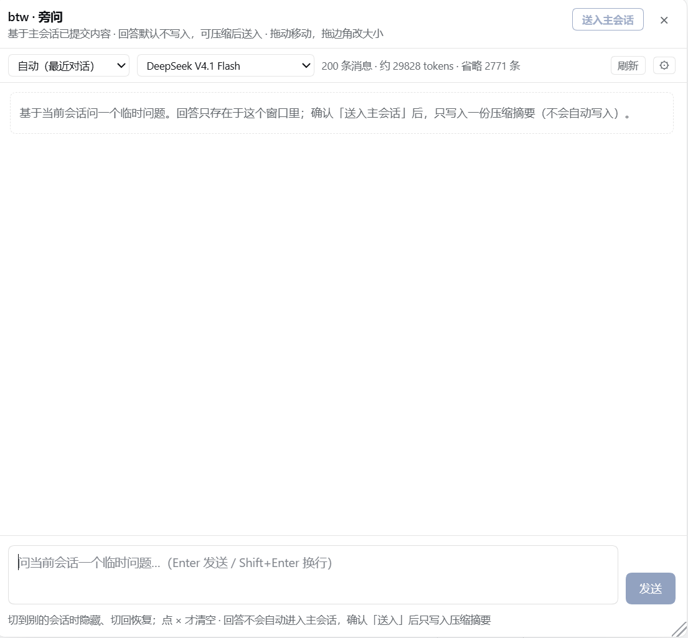
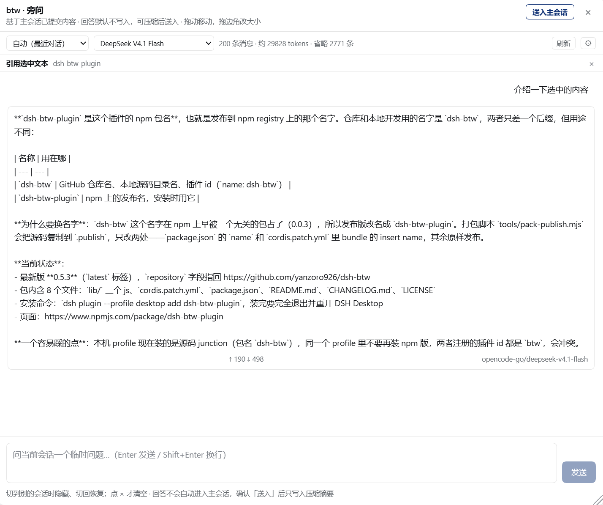

# dsh-btw

在 DSH 会话里随时插一个 **btw（by the way）旁问**：它继承当前会话的上下文，但回答只留在临时弹窗里，**默认不进入主会话记忆**。需要留痕时，可以把整段旁问压缩成摘要，预览、编辑后再「送入主会话」。

适合这些场景：主会话里有个名词没看懂、想确认某段输出的含义、想在不打断主任务的情况下先问一句。

## 界面





## 功能

- **一次性旁问**：输入框右侧的 `btw` 按钮，或输入 `/btw` 命令，打开一个独立浮窗提问；回答流式显示，支持 Markdown。
- **继承会话上下文**：自动携带当前会话的模型可见历史。上下文栏可在「自动 / 最近 40 条 / 最近 120 条 / 全部 / 全部但不含工具输出」之间切换，并显示将发送的条数与估算 token；超出上限时从旧到新裁剪，并标出省略条数。
- **继续追问**：同一弹窗里可以接着问，前几轮问答会作为上下文回传（有上限），但不会写回主会话。
- **选中文本提问**：先选中一段文字再点 `btw`，弹窗会引用该段文字（最多 2000 字符），适合问「这是什么意思」「这里为什么这么写」。
- **独立模型与参数**：可为旁问单独选择模型（不影响主会话），并调整温度、最大输出 tokens、推理强度；设置只作用于 btw。
- **用量与重试**：每条回答显示本次调用的 token 用量；失败时可一键重试，也可随时停止生成。
- **自由浮窗**：拖动标题栏移动、拖边缘缩放、双击标题栏最大化；位置和大小会被记住。
- **按会话隔离**：切到别的会话时窗口自动隐藏（上下文与选中文字都属于原会话），切回时窗口和对话恢复；只有点 × 才关闭并清空。
- **送入主会话**：把整段旁问压缩成「我问了什么 / 结论 / 关键细节 / 仍未解决」四节摘要，在预览里改好再确认写入；主会话会收到一张「btw 旁问记录」通知卡，但不会立刻被唤醒回复。

## 安装

要求 DSH Desktop 0.2.1 或更新的版本。

从 npm 安装：

```powershell
dsh plugin --profile desktop add dsh-btw-plugin
```

然后**完全退出并重新打开 DSH Desktop**（不是刷新页面）。打开任意会话，输入框右侧出现 `btw` 即安装成功。

从源码安装：

```powershell
git clone https://github.com/yanzoro926/dsh-btw.git
dsh plugin --profile desktop add file:D:/path/to/dsh-btw
```

## 使用

1. 点输入框右侧的 `btw`，或输入 `/btw` 后回车，打开弹窗。
2. 输入问题，Enter 发送，Shift+Enter 换行。
3. 顶部「上下文」栏可以调整这次旁问携带多少会话历史，点「刷新」重新读取。
4. 右侧模型下拉可切换旁问专用模型；⚙ 里可调温度、输出上限、推理强度和按钮显隐。
5. 先选中一段文字再打开，会把选中内容作为引用带进问题；引用条右侧的 × 可清除。
6. 切到其他会话时窗口会隐藏，切回原会话自动恢复；点 × 或按 Esc 关闭并清空当前会话的旁问。

## 送入主会话

如果旁问的结论值得让主会话记住：

1. 点弹窗头部的「送入主会话」。
2. 等待生成压缩摘要（用当前旁问模型，四节结构，最多约 900 字；生成失败会改用本地兜底摘要）。
3. 在预览层里检查、修改，点「确认送入」。

写入后，主会话的下一轮请求会带上这条记录；DSH 把它显示为上下文/通知卡，而不是你的消息气泡。它**不会**触发主会话立即回复，也不创建新的 turn。

限制：

- 只对当前进程里打开的会话可用；目标会话正在生成回答时会拒绝写入，等它结束再送。
- 摘要上限 8000 字；写入不可撤销。
- 同一段对话写入后会显示「已送入 ✓」并禁用；切换会话再切回不会重复写，但重新生成同一份内容并再次确认仍会再写一条。

## 隐私

| 行为 | 会不会发生 |
| --- | --- |
| 向主会话追加消息 | 默认不会；只有点「确认送入」才追加一条 `user/message`（`source.kind='btw'`） |
| 创建 Agent / 子会话 / 会话文件 | 不会 |
| 写入标题、压缩、搜索索引、turn/step | 不会 |
| 插件自己持久化问题或回答 | 不会 |
| 调用模型 provider | 会——旁问就是一次正常的模型调用 |

弹窗内的问答、引用和草稿都只存在页面内存里；关闭即丢弃。

## 配置

以下配置可在 Cordis 插件配置里覆盖（默认值来自 `lib/logic.js`）：

| 键 | 默认 | 作用 |
| --- | --- | --- |
| `enabled` | `true` | 关闭后不注册任何路由 |
| `maxParentMessages` | `200` | 「自动」范围下最多携带多少条父会话消息 |
| `maxRangeMessages` | `1000` | 「全部」/「不含工具输出」范围的硬上限 |
| `defaultRecentMessages` | `40` | 「最近 N 条」的默认值 |
| `maxPriorTurns` | `20` | 弹窗内追问最多回传多少条历史 |
| `maxQuestionChars` | `8000` | 单次问题长度上限 |
| `requestTimeoutMs` | `300000` | 单次旁问的超时 |
| `summaryTimeoutMs` | `60000` | 生成送入摘要的超时（超时用本地兜底） |
| `maxSummaryChars` | `8000` | 确认写入时摘要的长度上限 |

## 已知限制

- 引用文本最多 2000 字符，超出部分截断；跨 shadow DOM 的选区可能取不到，此时按普通旁问打开。
- 上下文栏里的 token 数是按字符粗估，实际计费以回答下方的 usage 为准。
- 某些 provider 不返回 usage、不认推理强度，界面会相应隐藏或忽略。
- 模型下拉来自各 provider 的模型目录；目录为空时可手动填写 provider/model。
- 浮窗位置、范围、模型等偏好保存在当前浏览器的 `localStorage`，不跨设备同步。
- 依赖 DSH 会话的两个内部方法读取历史，已做降级；DSH 大版本升级后如遇异常，请更新插件。

## 开发

```powershell
npm run check        # 语法检查
npm run test:direct  # 63 个测试
```

版本记录见 [CHANGELOG.md](CHANGELOG.md)。

## License

MIT
